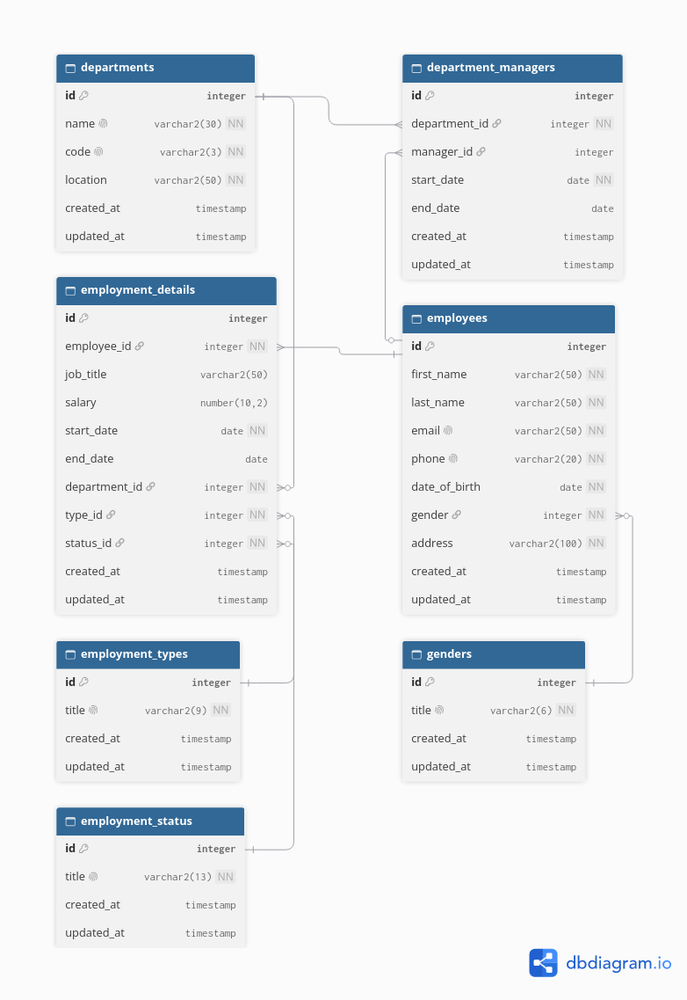

# SmartERP

An ERP learning project focused on the HR domain: employees, departments, employment records, and department manager history against an Oracle database. The schema design is fully built out in Oracle; the ASP.NET Core web app implements it feature by feature.



## Structure

```
SmartERP.slnx
├── src/
│   ├── SmartERP.Web      # ASP.NET Core MVC front end
│   └── SmartERP.Data     # Data layer: repositories, typed exceptions, raw ADO.NET
└── db/                   # Oracle SQL scripts, run in numeric order on every rebuild
    ├── 00_drop.sql       # Drop all objects for a clean rebuild
    ├── 01_schema.sql     # Tables, constraints, unique indexes
    ├── 02_seed.sql       # Reference and sample data
    ├── 03_triggers.sql   # Triggers that stamp updated_at on row updates
    ├── 04_test.sql       # Empty placeholder for ad-hoc test queries
    └── 05_procedures.sql # KV stored procedures: sp_assign_manager (atomic end-then-insert manager assignment)
```

Rebuild the database after every schema change: run all six scripts in filename order against an Oracle instance. Dropping a table drops its identity sequence too, so ids restart at 1 per rebuild; anyone hard-coding lookup or row ids in code instead of reading them from queries will drift.

## Data model

Seven tables in three groups.

Lookup tables:

| Table | Columns |
|---|---|
| `genders` | `title` unique |
| `employment_types` | `title` unique |
| `employment_status` | `title` unique |

Main tables:

| Table | What it stores |
|---|---|
| `employees` | Personal info: names, unique email and phone, date of birth, gender, address, and `is_deleted` for the soft-delete flag |
| `departments` | Name, unique 3-letter code, location, established date |
| `employment_details` | One job assignment: job title, salary, start and end dates, plus FKs to employee, department, type, and status |
| `department_managers` | Management assignment: department, manager, start and end dates |

Design rules worth noting:

- All primary keys use `number generated always as identity`.
- Every table carrying real data has `created_at` (defaults to `systimestamp`) and `updated_at` (stamped by the triggers in `03_triggers.sql`).
- `salary >= 0` is enforced, and `end_date`, where present, must be later than `start_date`.
- Two function-based unique indexes prevent duplicate open assignments:
  - `uq_det_current_job`: an employee can have only one `employment_details` row with a null `end_date`, so only one current job.
  - `uq_dept_current_manager`: a manager can head only one department at a time.
- Soft delete: `UPDATE employees SET is_deleted = 1` hides the row from app reads (every read filters `is_deleted = 0`); children stay intact. Deleting an employee together with their dependent rows is an explicit separate transaction in the data layer.
- Closed rows (with an `end_date`) are the history; there is no separate history table.

## Relationships

```
employees 1───* employment_details *───1 departments
employees 1───* department_managers *───1 departments
employment_details *───1 employment_types
employment_details *───1 employment_status
employees *───1 genders
```

The diagram above (generated with dbdiagram.io) shows the same model with column types.

## Running the database

Execute the scripts in `db/` in filename order against an Oracle instance: `00_drop`, `01_schema`, `02_seed`, `03_triggers`, `04_test`, `05_procedures`.

## Running the web app

```bash
dotnet run --project src/SmartERP.Web
```

Requires the .NET SDK and:

1. The six `db/` scripts executed (see above).
2. The Oracle connection string under `ConnectionStrings:Oracle`. It lives in no appsettings file on purpose; provide it either with user secrets:

```bash
dotnet user-secrets set "ConnectionStrings:Oracle" "User Id=...;Password=...;Data Source=..." --project src/SmartERP.Web
```

or with an environment variable `ConnectionStrings__Oracle`. Without one, startup fails in `OracleDbConnection` by design: no default credentials.

## What works

- Departments: full CRUD, with a per-department manager-assignment page (assign employee as manager, close the assignment with an end date; a manager may head only one department at a time).
- Employees: full CRUD with soft delete plus a double-gated "delete with dependencies" purge, and a per-employee employment history page (record assignments, backfill closed history, close the open one; an employee holds only one open assignment).
- Dashboard: read-only statistics page (nav "Dashboard") built from the employment_details and department_managers closed rows. KPI tiles (headcount, monthly payroll, hires and exits with 12-month comparisons), six charts rendered with the bundled Chart.js copy in `wwwroot/lib/chart/` (workforce-size area, hires-vs-exits bars over trailing 24 months, exits by status, employment-type mix, payroll by department, min/max salary range per department), plus action lists: departments without a current manager, employees in probation beyond 90 days, and employees on leave or serving notice. Trend months derive from history rows, so soft-deleting an employee retroactively removes their share of every month.
- Dropdown ids and titles come from the lookup tables themselves, not from code enums.
