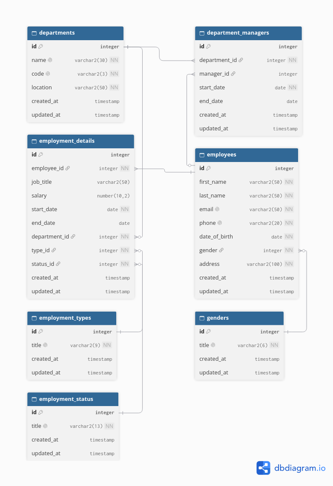

# SmartERP

An ERP learning project focused on the HR domain: employees, departments, employment records, and department manager history against an Oracle database. The schema design is fully built out in Oracle; the ASP.NET Core web app implements it feature by feature.



## Structure

```
SmartERP.slnx
├── src/
│   ├── SmartERP.Web      # ASP.NET Core MVC front end
│   └── SmartERP.Data     # Data layer: repositories, typed exceptions, raw ADO.NET
└── db/                   # Oracle SQL scripts, run in numeric order on every rebuild
    ├── 00_drop.sql       # Drop all objects for a clean rebuild
    ├── 01_schema.sql     # Tables, constraints, unique indexes
    ├── 02_procedures.sql # Stored procedures: sp_assign_manager (atomic end-then-insert manager assignment)
    ├── 03_triggers.sql   # Triggers that stamp updated_at on row updates
    ├── 04_seed.sql       # Reference and sample data
├── 05_migrate.sql    # Chain runner: executes 00..04 in order, 05_test ad-hoc checks
├── 05_test.sql       # Empty placeholder for ad-hoc test queries
├── 06_positions.sql  # One-shot migration: existing installs move from employment_details.job_title onto positions
├── 07_leave.sql      # One-shot migration: existing installs gain leave_types, leave_statuses, leave_requests, leave_balances
└── 08_department_hierarchy.sql # One-shot migration: existing installs gain departments.parent_department_id, its self-FK and no-self-parent check
├── 09_status_events.sql        # One-shot migration: existing installs gain status_events, its FKs and the transition check
├── 10_app_users_audit.sql  # One-shot migration: existing installs gain app_users and audit_log
├── 11_realistic_seed.sql   # Optional large realistic seed for load/UX testing
```

Rebuild the database after every schema change: run the chained scripts in filename order on every rebuild. Dropping a table drops its identity sequence too, so ids restart at 1 per rebuild; anyone hard-coding lookup or row ids in code instead of reading them from queries will drift. Schema-level migrations for already-populated databases live in numbered follow-up scripts (`06_positions.sql` is one: it backfills positions from the former free-text job_title column, repoints employment_details, drops job_title, and is re-runnable).

## Data model

Twelve tables in two groups.

Lookup tables:

| Table | Columns |
|---|---|
| `genders` | `title` unique |
| `employment_types` | `title` unique |
| `employment_status` | `title` unique |
| `leave_types` | `title` unique: the leave kinds a request can be booked against |
| `leave_statuses` | `title` unique: Pending, Approved, Rejected, Cancelled. Pending seeds as id 1 |

Main tables:

| Table | What it stores |
|---|---|
| `employees` | Personal info: names, unique email and phone, date of birth, gender, address, and `is_deleted` for the soft-delete flag |
| `positions` | Position titles referenced by jobs; `employment_details` points at a position instead of carrying a free-text `job_title` |
| `departments` | Name, unique 3-letter code, location, established date, and nullable `parent_department_id` for the reporting line |
| `employment_details` | One job assignment: position, salary, start and end dates, plus FKs to employee, department, type, and status |
| `department_managers` | Management assignment: department, manager, start and end dates |
| `leave_requests` | One leave request: employee, type, status, start and end dates, optional reason, and `decided_at` once it leaves Pending |
| `leave_balances` | One row per employee, leave type and year: `entitlement_days` set from the app, `used_days` moved only by approving or cancelling a request |

Design rules worth noting:

- All primary keys use `number generated always as identity`.
- Every table carrying real data has `created_at` (defaults to `systimestamp`) and `updated_at` (stamped by the triggers in `03_triggers.sql`).
- `salary >= 0` is enforced, and `end_date`, where present, must be later than `start_date`.
- Leave dates allow `end_date = start_date`: a single-day request is a normal request.
- `departments.parent_department_id` is a nullable self-FK: null means top level. `chk_dept_parent_not_self` blocks a row reporting to itself, and the app walks the ancestor chain so a department cannot report to one of its own sub-departments. Deleting a department that still has reports is blocked by the FK; there is no cascade.
- Department headcount is derived, never stored: open `employment_details` rows for non-deleted employees, counted per node and again across its whole subtree for the reporting structure page.
- Three function-based unique indexes prevent duplicate open rows:
  - `uq_det_current_job`: an employee can have only one `employment_details` row with a null `end_date`, so only one current job.
  - `uq_dept_current_manager`: a manager can head only one department at a time.
  - `uq_lr_open_request`: an employee can have only one Pending `leave_requests` row, so only one request waiting for a decision. The index compares `status_id` against `leave_statuses.id = 1`, which is why the seed inserts Pending first and fails loudly if anything else claims id 1.
- `leave_balances.used_days` is written by two paths only: approving a request adds its inclusive days, cancelling an approved request gives them back. `chk_bal_used` keeps it between 0 and `entitlement_days`.
- Soft delete: `UPDATE employees SET is_deleted = 1` hides the row from app reads (every read filters `is_deleted = 0`); children stay intact. Deleting an employee together with their dependent rows is an explicit separate transaction in the data layer.
- Closed rows (with an `end_date`) are the history of assignments. Status transitions inside an
  open assignment are recorded in `status_events` (from, to, when, note); the final status
  stays on the assignment row, so existing reads remain unchanged.

## Relationships

```
employees 1───* employment_details *───1 departments
departments 1───* departments (parent_department_id)
employment_details *───1 positions
employees 1───* department_managers *───1 departments
employment_details *───1 employment_types
employment_details *───1 employment_status
employees *───1 genders
employees 1───* leave_requests *───1 leave_types
leave_requests *───1 leave_statuses
employees + leave_types 1───* leave_balances
```

The diagram above (generated with dbdiagram.io) shows the same model with column types.

## Running the database

Execute the scripts in `db/` in filename order against an Oracle instance: `00_drop`, `01_schema`, `02_seed`, `03_triggers`, `04_test`, `05_procedures`.

## Running the web app

```bash
dotnet run --project src/SmartERP.Web
```

Requires the .NET SDK and:

1. The six `db/` scripts executed (see above).
2. The Oracle connection string under `ConnectionStrings:Oracle`. It lives in no appsettings file on purpose; provide it either with user secrets:

```bash
dotnet user-secrets set "ConnectionStrings:Oracle" "User Id=...;Password=...;Data Source=..." --project src/SmartERP.Web
```

or with an environment variable `ConnectionStrings__Oracle`. Without one, startup fails in `OracleDbConnection` by design: no default credentials.

## What works

- Departments: full CRUD, with a reporting line set on create or update and a reporting-structure page that lists departments depth-first with the department each one reports to, its own open headcount, and the headcount across everything below it. The update form never offers the department itself or its descendants as a parent, and the database rejects a self-parent. A per-department manager-assignment page assigns an employee as manager and closes the assignment with an end date; a manager may head only one department at a time.
- Employees: full CRUD with soft delete plus a double-gated "delete with dependencies" purge, and a per-employee employment history page (record assignments, backfill closed history, close the open one; an employee holds only one open assignment).
- Dashboard: read-only statistics page (nav "Dashboard") built from the employment_details and department_managers closed rows. KPI tiles (headcount, monthly payroll, hires and exits with 12-month comparisons), six charts rendered with the bundled Chart.js copy in `wwwroot/lib/chart/` (workforce-size area, hires-vs-exits bars over trailing 24 months, exits by status, employment-type mix, payroll by department, min/max salary range per department), plus action lists: departments without a current manager, employees in probation beyond 90 days, and employees on leave or serving notice. Trend months derive from history rows, so soft-deleting an employee retroactively removes their share of every month.
- Leave: request, decide and balance pages. An employee holds one Pending request at a time (enforced by `uq_lr_open_request`), a new request may not overlap approved leave, approving checks the year's entitlement first and then moves `used_days` in the same transaction, and cancelling an approved request gives the days back. Balances are set per employee, leave type and year from the balances page. The dashboard carries an "On leave today" list and an absence strip (days lost this month, requests waiting, people out today).
- Dropdown ids and titles come from the lookup tables themselves, not from code enums.
